


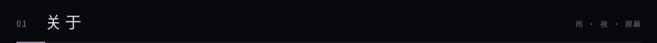

夜里屏幕是亮的，外面在下雨。仓库里是装系统、救系统、双系统的笔记，写得短，能跑通就留。


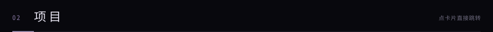

<a href="https://github.com/shenchuchu91-hub/Linux-DualBoot-Steam-Guide">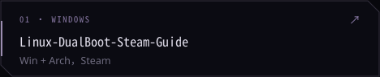</a>
<a href="https://github.com/shenchuchu91-hub/moe-game-launcher">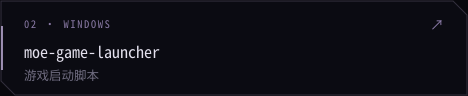</a>
<a href="https://github.com/shenchuchu91-hub/Linux-Desktop-Matrix">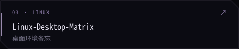</a>
<a href="https://github.com/shenchuchu91-hub/linux">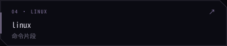</a>
<a href="https://github.com/shenchuchu91-hub/dotfiles">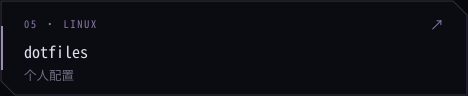</a>
<a href="https://github.com/shenchuchu91-hub/Arch-Linux-Guide">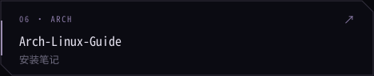</a>
<a href="https://github.com/shenchuchu91-hub/Arch-Disaster-Recovery">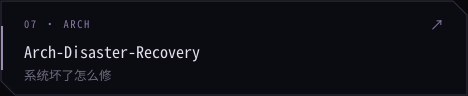</a>
<a href="https://github.com/shenchuchu91-hub/Nyarch-Linux-Guide">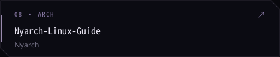</a>
<a href="https://github.com/shenchuchu91-hub/SCPSL-ArchLinux-Optimization">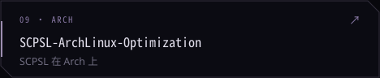</a>
<a href="https://github.com/shenchuchu91-hub/backend-learning">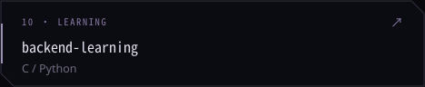</a>

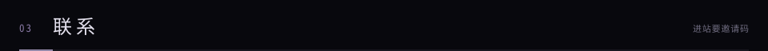

<a href="https://chuchuwansui.top">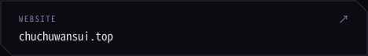</a>
<a href="mailto:shenchuchu91@gmail.com">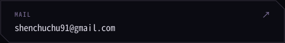</a>

