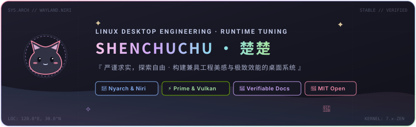

  <!-- 本地高清自托管 Banner -->
  

    

  <!-- 本地自托管高可用动态打字机效果 (彻底杜绝第三方加载失效) -->
  

   

  <!-- 徽章栏 (庄重对齐) -->
  

    
    
    
    
    
    
  

---

### ⛩️ 个人概述与工程哲学 (Profile & Principles)

你好！我是 **楚楚 (shenchuchu91-hub)**。一名热衷于 **Linux 桌面架构、底层运行调优与二次元美学** 的开源探索者。

在开源与系统折腾的道路上，我始终秉持以下三条严谨的工程准则：

- 📐 **客观与可复现 (Verifiable & Objective)**：拒绝未经验证的调优玄学。所有项目与配置均提供具体的硬件测试基准、环境对照以及清晰的原理分析；
- 🛡️ **安全与数据保障 (Safety & Non-destructive)**：所有自动化安装脚本均采用无损软链接机制，并在执行前强制生成时间戳配置备份，确保随时可一键回滚；
- 🌸 **严谨与美学统一 (Harmony of Form & Function)**：坚信“代码应当严谨，桌面亦当优雅”。在 Arch Linux 的严谨底座之上，融合 Niri 卷轴式平铺架构与二次元淡雅色彩体系。

---

### 📐 技术架构与实践领域 (Technical Focus)

| 核心领域 | 关键技术栈 | 实践方向与解决方案 |
| :--- | :--- | :--- |
| **🖥️ 桌面环境与平铺架构** | `Nyarch Linux` · `Niri WM` · `Wayland` · `Fish` | 卷轴式无限视口排列、软件窗口智能浮动规则 (`shorin-windowrules.kdl`)、Material You 动态色彩提取 |
| **🎮 图形栈与游戏运行调度** | `Vulkan 1.3` · `NVIDIA Prime` · `Gamescope` · `MangoHud` | 混合显卡双 GPU 渲染分流、1080p @ 144Hz 锁帧与 FSR 超分、Unity 引擎底层多核线程分配 |
| **🛠️ 跨系统兼容与引导排错** | `GRUB / ESP` · `NTFS-3G` · `Proton Compatdata` | Windows + Arch 双系统时间同步 (RTC/UTC)、NTFS 符号链接崩溃排查、Google Antigravity 中文化支持 |

---

### ⚡ 当前状态与焦点 (Current Focus)

- 🔭 **主力维护工程**：
  - [`Arch-Linux-Guide`](https://github.com/shenchuchu91-hub/Arch-Linux-Guide)：纯正 upstream Arch Linux 工程架构指南与无损部署套件；
  - [`Linux-Desktop-Matrix`](https://github.com/shenchuchu91-hub/Linux-Desktop-Matrix)：对标全平台 Linux (Arch / NixOS / Fedora 等) 的桌面管理与平铺架构交互式全景矩阵；
  - [`moe-game-launcher`](https://github.com/shenchuchu91-hub/moe-game-launcher)：面向 Linux 混合显卡笔记本的无损调度与诊断工具箱；
  - [`SCPSL-ArchLinux-Optimization`](https://github.com/shenchuchu91-hub/SCPSL-ArchLinux-Optimization)：基于老玩家实践整理的 Unity 线程优化与 Wayland 准星校准方案；
- 🛠️ **正在调校演进**：持续优化 Niri 卷轴平铺窗口吸附动画与 Fish Shell 自动化配置流；
- 💬 **学术与技术探讨**：欢迎交流 Wayland 协议兼容、Proton 运行机制及自动化部署脚本的幂等性设计。

---

### 🌟 核心开源项目矩阵 (Featured Projects)

| 项目名称 | 解决的核心问题 | 适用人群 / 场景 | 核心技术栈 | 快速入口 |
| :--- | :--- | :--- | :--- | :---: |
| 🏛️ **[Arch-Linux-Guide](https://github.com/shenchuchu91-hub/Arch-Linux-Guide)** | 纯正 Arch Linux 完整实践指南：从裸机安装、硬件驱动到 Niri 桌面工程与自动部署 | Arch 开发者 / 纯血 Linux 玩家 | `Arch Linux` · `System Architecture` | [立即查看 →](https://github.com/shenchuchu91-hub/Arch-Linux-Guide) |
| 🌸 **[Linux-Desktop-Matrix](https://github.com/shenchuchu91-hub/Linux-Desktop-Matrix)** | 跨发行版桌面环境与平铺架构全景矩阵：Niri (Shorin/Vanilla)、DMS、Hyprland、GNOME 终端交互部署套件 | 全 Linux 用户 / NixOS / 探索者 | `Multi-Distro` · `NixOS Flake` · `Wayland` | [立即查看 →](https://github.com/shenchuchu91-hub/Linux-Desktop-Matrix) |
| 🎯 **[SCPSL-ArchLinux-Optimization](https://github.com/shenchuchu91-hub/SCPSL-ArchLinux-Optimization)** | Unity 引擎多核负载不均、视口缩放导致的准星脱节与掉帧 | SCPSL 玩家 / Unity Linux 环境 | `Unity` · `Engine Config` | [立即查看 →](https://github.com/shenchuchu91-hub/SCPSL-ArchLinux-Optimization) |
| 🎮 **[moe-game-launcher](https://github.com/shenchuchu91-hub/moe-game-launcher)** | 混合显卡笔记本独显委派、Gamescope 144Hz 锁帧与环境检测 | Linux 游戏本玩家 / Steam 玩家 | `Prime Offload` · `Gamescope` | [立即查看 →](https://github.com/shenchuchu91-hub/moe-game-launcher) |
| 🛡️ **[Linux-DualBoot-Steam-Guide](https://github.com/shenchuchu91-hub/Linux-DualBoot-Steam-Guide)** | 双系统 8 小时时差、NTFS 分区只读锁死与 Proton 启动排查 | Windows + Arch 双系统用户 | `DualBoot` · `NTFS` · `Proton` | [立即查看 →](https://github.com/shenchuchu91-hub/Linux-DualBoot-Steam-Guide) |
| 🌸 **[dotfiles](https://github.com/shenchuchu91-hub/dotfiles)** | Niri 卷轴平铺、Fish 终端与带安全备份机制的部署脚本 | Arch / Nyarch 桌面配置需求者 | `Niri` · `Fish` · `Starship` | [立即查看 →](https://github.com/shenchuchu91-hub/dotfiles) |
| 📖 **[Nyarch-Linux-Guide](https://github.com/shenchuchu91-hub/Nyarch-Linux-Guide)** | 官方镜像导航、GNOME 动态调色与 Niri 进阶指南 | Nyarch 新手与桌面美化爱好者 | `Guide` · `Wayland` · `Material` | [立即查看 →](https://github.com/shenchuchu91-hub/Nyarch-Linux-Guide) |
| 🛡️ **[disclaimer](https://github.com/shenchuchu91-hub/disclaimer)** | 系统底层修改、游戏公平竞技与 MIT 开源安全守则 | 全局项目的统一规范准则 | `Safety` · `Policy` · `EULA` | [立即查看 →](https://github.com/shenchuchu91-hub/disclaimer) |

---

### 💻 硬件测试基准与环境对照 (System Specs & Testing Rig Baseline)

为保证方案的可验证性与工程严谨度，下表列出作者的实际验证环境与建议的最低门槛：

| 硬件 / 环境项目 | 推荐测试参考配置 (Reference Tested Rig) | 最低运行参考门槛 (Minimum Requirements) |
| :--- | :--- | :--- |
| **处理器 (CPU)** | 现代 12~16 线程处理器 (如 i7-13620H / Ryzen 7) | 4 核心 8 线程 64 位 x86_64 处理器 |
| **独立显卡 (GPU)** | NVIDIA RTX 30 / 40 / 50 系列独显 (支持 Prime Offload) | 支持 Vulkan 1.3 的独立显卡或现代核显 |
| **运行内存 (RAM)** | 16 GB DDR4 / DDR5 高速内存 | 8 GB RAM (保障桌面日常流畅) |
| **显示规格 (Display)** | 1080p @ 144Hz IPS 高刷新率屏幕 | 1080p @ 60Hz 标准显示设备 |
| **操作系统 (OS)** | **Nyarch Linux** / **Arch Linux** (Wayland 会话) | 任意 64 位 Arch / Arch-based 发行版 |

> 📌 *工程说明：以上测试参数基于作者实际开发机验证。不同设备的硬件微架构与驱动分支存在差异，调优时请参照个人硬件规格合理适配。*

---

### 🧭 快速开始与传送门 (Quick Navigation)

根据你的需求，点击即可直达对应的核心仓库：

- 🏛️ **查阅纯正 Arch Linux 完整系统安装与桌面工程体系？** 👉 前往 [`Arch-Linux-Guide`](https://github.com/shenchuchu91-hub/Arch-Linux-Guide)
- 🌸 **探索跨发行版（Arch / NixOS / Fedora）桌面与平铺全景矩阵？** 👉 前往 [`Linux-Desktop-Matrix`](https://github.com/shenchuchu91-hub/Linux-Desktop-Matrix)
- 🪟 **需要一套完整的 Niri 卷轴式桌面配置？** 👉 前往 [`dotfiles`](https://github.com/shenchuchu91-hub/dotfiles)
- 🎮 **双显卡笔记本运行游戏需要指定独显与锁帧？** 👉 前往 [`moe-game-launcher`](https://github.com/shenchuchu91-hub/moe-game-launcher)
- 🎯 **运行 SCPSL 遇到准星偏移或帧率不稳？** 👉 前往 [`SCPSL-ArchLinux-Optimization`](https://github.com/shenchuchu91-hub/SCPSL-ArchLinux-Optimization)
- 🪟 **双系统遇到时间不同步、NTFS 盘挂载问题？** 👉 前往 [`Linux-DualBoot-Steam-Guide`](https://github.com/shenchuchu91-hub/Linux-DualBoot-Steam-Guide)
- 📖 **查阅 Nyarch Linux 镜像与 GNOME 动态美化逻辑？** 👉 前往 [`Nyarch-Linux-Guide`](https://github.com/shenchuchu91-hub/Nyarch-Linux-Guide)
- 🛡️ **查阅通用安全规范与数据备份机制？** 👉 前往 [`disclaimer`](https://github.com/shenchuchu91-hub/disclaimer)

---

  

    🛡️ <b>使用安全与免责提示</b>：使用本账号下项目前请阅读 <a href="https://github.com/shenchuchu91-hub/disclaimer">全局免责声明与安全守则 (Disclaimer)</a>
  

  Designed with precision &amp; care for Arch Linux · <b>shenchuchu91-hub</b>

